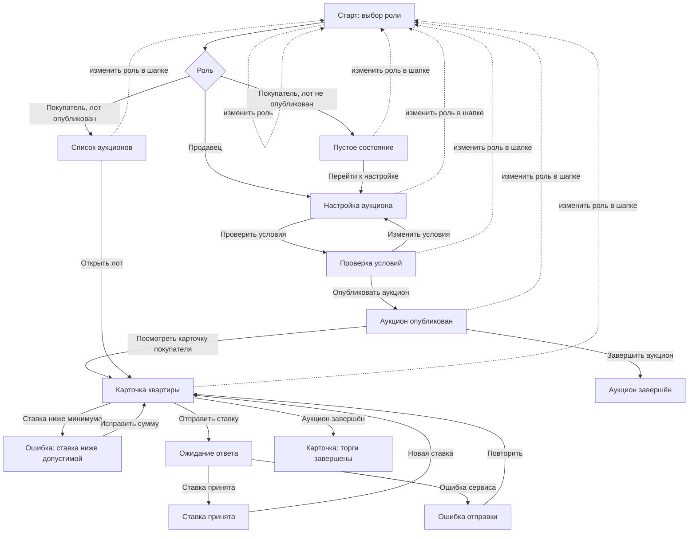

# Карта экранов — «Аукцион квартиры»

## Легенда

- **Продавец:** настраивает условия, проверяет их и публикует аукцион.
- **Покупатель:** видит пустое состояние до публикации, открывает опубликованный лот и делает ставку.
- **Состояния ставки:** ниже минимума, ожидание ответа, принята, ошибка.
- **Завершение:** доступно в демо-панели; оно закрывает приём ставок и показывает финальную цену.

Роль выбирается на первом экране и может быть изменена в любой момент через контрол «Роль» в шапке.
